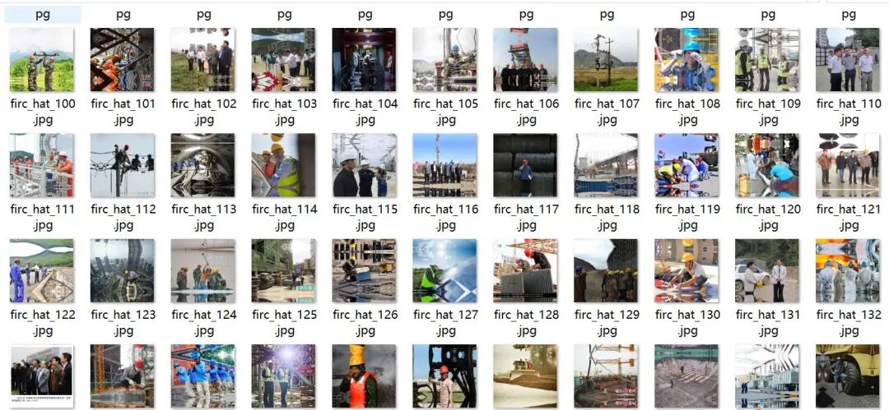
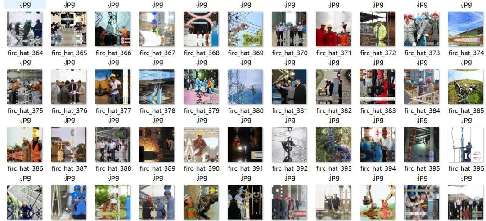
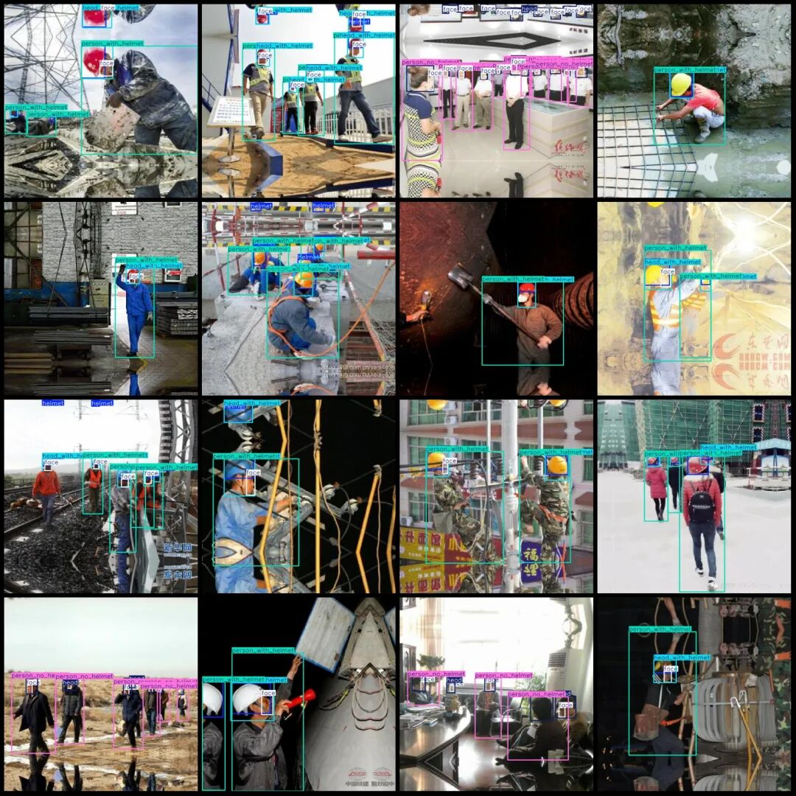

# Construction Site Electrical Equipment Safety Helmet Wearing Detection Dataset VOC+YOLO format with 4999 images in 7 categories

Dataset format: Pascal VOC format + YOLO format (txt file without split path, only containing jpg images and corresponding VOC format xml files and yolo format txt files)

Number of images (number of jpg files): 4999

Number of annotations (number of xml files): 4999

Number of annotations (number of txt files): 4999

Label category count: 7

Label category names (Note that the order of yolo format categories does not correspond to this, but is based on the classes.txt in the labels folder): ["face", "head", "head_with_helmet", "helmet", "person", "person_no_helmet", "person_with_helmet"]

Number of boxes labeled in each category:

Face (Facial) Frame Count = 14131

Head (unhelmeted head) box count = 6120

Head_with_helmet (head with helmet) frame count = 16042

Helmet (Safety Cap) Frame Count = 19245

Person (person) Frames = 8

person_no_helmet (unhelmeted person) frame count = 5248

person_with_helmet (person wearing a helmet) frame count = 14762

Total frames: 75,556

Image resolution: 640x640

Using labelImg:

Annotation rules: Draw a rectangle around the category.

Important Notice: No

Special : This dataset does not guarantee the accuracy of the trained models or weight files.

Image Preview:

Annotation example:

## Payment

Here is a pay link on Stripe ( https://buy.stripe.com/3cs8yP7sY87d0vu9AB ). Please contact me lonlonago@foxmail.com after funding $89, and I will send you a complete data files , thank you!

